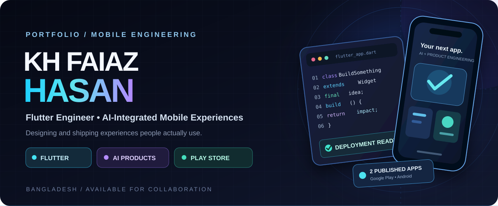
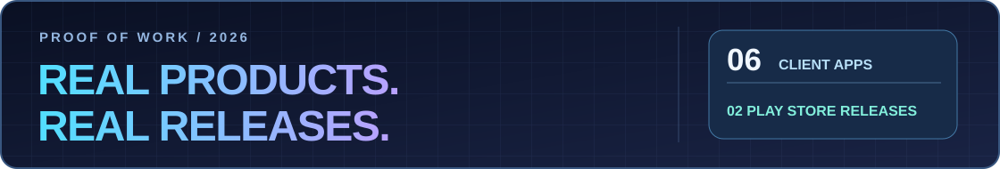

 

&nbsp;

&nbsp;

  

**Flutter / Dart · AI-powered applications · Firebase & APIs · Android releases**

Mobile developer from Bangladesh • Product thinking, robust engineering, and thoughtful user experiences.

---

### ◉ THE SHORT VERSION

I’m **Kh Faiaz Hasan**, a Flutter developer focused on turning complex requirements into polished mobile products. My work spans **AI-integrated experiences, real-time data, mapping, authentication, subscription/payment flows, and production app delivery**.

I’ve worked on client projects ranging from **AI nursing education** and **food recognition** to **real-estate management** and **AI travel planning**. I enjoy both the craft of the interface and the engineering that keeps it reliable.

### 01 / SHIPPED TO GOOGLE PLAY

Two public releases you can explore beyond a code repository.

<table>
<tr>
<td width="50%" align="center" valign="top">

<h3>🏡 PROPPIN</h3>
<strong>Real Estate Management Platform</strong>

Organize properties, media, documents, locations, and real-estate workflows in one mobile experience.

<code>Flutter</code> <code>Firebase Auth</code> <code>Dio</code> <code>Provider</code>

</td>
<td width="50%" align="center" valign="top">

<h3>🌍 VOYAGE AI</h3>
<strong>AI-Powered Travel Companion</strong>

AI itineraries, a streaming travel assistant, Google Maps routes, trip documents, and connected travel tools.

<code>Flutter</code> <code>AI / SSE</code> <code>Firebase</code> <code>Maps</code>

</td>
</tr>
</table>

Store listings are linked directly; some project source code is private or client-owned.

### 02 / INDUSTRY & CLIENT PROJECTS

Beyond the two published apps, these products represent different domains and engineering challenges.

<table>
<tr>
<td align="center" valign="top" width="50%">

<h3>🥗 Ojais Food Scanner</h3>
<strong>AI-based food recognition</strong>

Real-time food recognition and analysis with API-powered experiences and subscription tooling.

<code>Flutter</code> <code>GetX</code> <code>Dio</code> <code>RevenueCat</code>
</td>
<td align="center" valign="top" width="50%">

<h3>🩺 STEMRN</h3>
<strong>AI-enabled nursing education</strong>

Professional nursing education experience with live content, authentication, and Stripe subscription integration.

<code>Flutter</code> <code>Firebase Auth</code> <code>Stripe</code>
</td>
</tr>
<tr>
<td align="center" valign="top" width="50%">

<h3>🤖 Jaysea AI</h3>
<strong>Identity-driven AI chatbot</strong>

Personalized conversational experience that adapts to user-defined tone, identity, and boundaries.

<code>Flutter</code> <code>Dio</code> <code>RxDart</code> <code>GetX</code>
</td>
<td align="center" valign="top" width="50%">

<h3>📦 Kind Pack</h3>
<strong>Enterprise SaaS · In development</strong>

Multi-role enterprise platform exploring commerce workflows, access control, and AI-assisted calculations.

<code>Flutter</code> <code>Firebase Auth</code> <code>REST APIs</code>
</td>
</tr>
</table>

<a href="https://www.faiazis.live/#portfolio"><strong>See the complete industry project portfolio →</strong></a>

### 03 / UNDER THE HOOD — VOYAGE AI

**One published product, multiple hard engineering problems.**

<table>
<tr>
<td valign="top" width="50%">

**What I worked on**
- Flutter app UI and screen implementation
- API integration across major app features
- Live AI chat with streamed responses
- Google Maps and route visualization
- Firebase and Google authentication
- PayPal checkout integration
- Document uploads and PDF viewing

</td>
<td valign="top" width="50%">

**Selected implementation details**
- Dio-based SSE parsing for streamed AI tokens
- Dynamic map markers and polyline decoding
- Session and authentication interceptors
- Reactive state and local persistence
- Feature-oriented application structure
- Error handling and performance refinement

</td>
</tr>
</table>

**[Read the Voyage AI engineering case study →](https://www.faiazis.live/projects/voyage-ai)**

Detailed contributions and implementation notes are documented in the portfolio case study.

### 04 / MORE THINGS I'VE BUILT

My public repositories cover mobile apps, live data, full-stack systems, and experiments.

| Project | What it demonstrates | Explore |
| :--- | :--- | :--- |
| 🌱 **Bangla Carambola Companion** | AI-assisted agricultural diagnosis and bilingual product UI | [Live app](https://kamrangabondhu.app) · [Code](https://github.com/faiaz5415/bangla-carambola-companion) |
| ⚽ **Football Live Score** | Real-time football updates with Flutter and Firebase | [Repository](https://github.com/faiaz5415/Football-Live-score-real-time-App-using-firebase) |
| 📍 **Real-Time Map Tracker** | GPS tracking, custom map routes, and location handling | [Repository](https://github.com/faiaz5415/Real-Time-Map-Tracker-APP) |
| 🛒 **NexusCommerce + CRM** | React + Node.js + MongoDB commerce and CRM workspace | [Repository](https://github.com/faiaz5415/sazim_store_website) |
| 🍱 **MessMate Pro** | Meal and shared-expense management Flutter project | [Repository](https://github.com/faiaz5415/MessMate-Pro) |

<a href="https://github.com/faiaz5415?tab=repositories"><strong>Browse all repositories ↗</strong></a>

### 05 / TECH I REACH FOR

**Mobile & product engineering**

**APIs, infrastructure & web**

**Everyday engineering:** `Provider` · `GetX` · `BLoC` · `Dio` · `RxDart` · `REST APIs` · `Firebase Auth` · `SSE` · `Google Maps` · `Stripe` · `PayPal` · `SQLite` · `CI/CD`

### 06 / BACKGROUND

<table>
<tr><td><strong>🎓 Education</strong></td><td>B.Sc. in Computer Science & Engineering — Daffodil International University (2022–2025)</td></tr>
<tr><td><strong>🏅 Training</strong></td><td>Flutter Development — ICT Ministry & Bangladesh Computer Council</td></tr>
<tr><td><strong>📘 Further learning</strong></td><td>Flutter App Development (Ostad Pro) · UI/UX Design Fundamentals (Ostad)</td></tr>
</table>

### 07 / ACTIVITY & OPEN SOURCE

---

### HAVE A PRODUCT IN MIND?

**From Figma to Flutter. From APIs to release.**

&nbsp;

  
© Kh Faiaz Hasan · Crafted with focus, curiosity, and care.

